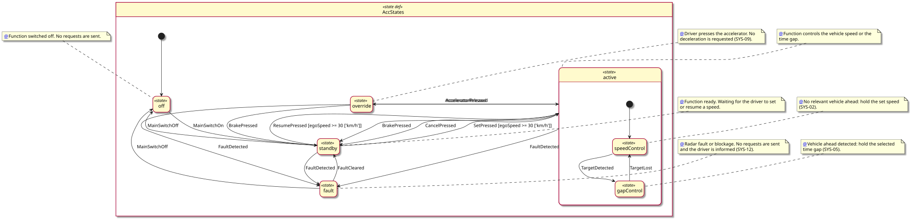
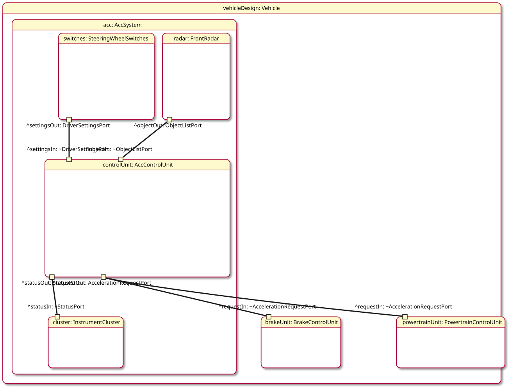
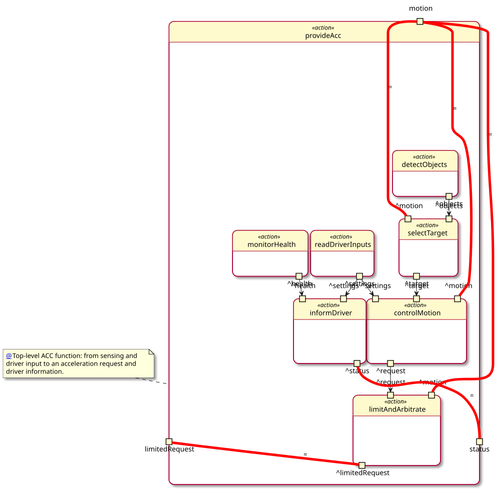

# Adaptive Cruise Control: an MBSE model in SysML v2


A complete, small model-based systems engineering (MBSE) example. It takes an **Adaptive Cruise Control (ACC)** function from stakeholder needs through requirements, logical and physical architecture, behaviour and analysis to verification. The model is written in the **SysML v2 textual notation**, which OMG formally adopted in June 2025. Every commit is checked automatically with the official open-source SysML v2 Pilot Implementation.

> All values are illustrative and based on public literature about ACC systems. The model contains no company data.

## What the model shows

| File | Content | SysML v2 elements used |
|---|---|---|
| [01_Context](model/01_Context.sysml) | System of interest, actors, use cases | `part def`, `use case def`, `actor`, `subject` |
| [02_StakeholderNeeds](model/02_StakeholderNeeds.sysml) | 6 stakeholder needs (STK) | `requirement def`, `stakeholder` |
| [03_SystemRequirements](model/03_SystemRequirements.sysml) | 12 system requirements (SYS) with measurable constraints, derived from the needs | `require constraint`, `#derivation connection` |
| [04_LogicalArchitecture](model/04_LogicalArchitecture.sysml) | Functional chain from sensing to acceleration request; logical components | `action def`, `item def`, `flow`, `bind`, `perform` |
| [05_Behaviour](model/05_Behaviour.sysml) | ACC state machine (off, standby, active with speed and gap control, override, fault) | `state def`, `transition`, `accept`, guards |
| [06_PhysicalArchitecture](model/06_PhysicalArchitecture.sysml) | Radar, ACC control unit, switches, cluster, brake and powertrain ECUs; ports and interfaces; design values; allocation; satisfaction | `port def`, `interface def`, `allocate`, `satisfy`, `exhibit` |
| [07_ComponentRequirements](model/07_ComponentRequirements.sysml) | 6 component requirements (CMP) derived from system requirements | `#derivation connection`, `satisfy` |
| [08_Analysis](model/08_Analysis.sysml) | Radar range analysis that justifies CMP-RAD-01 | `calc def`, `analysis def`, `objective` |
| [09_Verification](model/09_Verification.sysml) | 14 verification cases (TC) with method; TC-07 fully worked out with steps and a pass/fail verdict | `verification def`, `verify`, `VerificationMethod`, `PassIf` |

Each system requirement is a single "shall" statement in an [EARS](https://alistairmavin.com/ears/) sentence pattern. Where a requirement contains numbers, they are also written as a formal constraint, so a tool can check the design values against them.

## Diagrams

Rendered from the model with the pilot implementation (`scripts/render_diagrams.sh`).

**State machine**: ACC modes and transitions, with the requirement each transition implements



**Physical architecture**: components, ports and interfaces



**Functional chain**: from object detection to the limited acceleration request



More: [context and use cases](docs/diagrams/01_context.svg) · [system requirements](docs/diagrams/03_system_requirements.svg) · [TC-07 brake override test](docs/diagrams/09_tc07_brake_override.svg)

## Traceability

| Stakeholder need | System requirement | Component requirement | Verified by |
|---|---|---|---|
| STK-01 Hold a chosen speed | SYS-01 Set speed range 30–160 km/h | | TC-01 |
| | SYS-02 Speed within ±2 km/h | | TC-02 |
| | SYS-03 Activate only ≥ 30 km/h, no fault | | TC-03 |
| STK-02 Keep a safe distance | SYS-04 ≥ 3 time gaps, 1.0–2.2 s | CMP-RAD-01 Radar range ≥ 150 m | TC-04, TC-12 |
| | SYS-05 Time gap within ±0.2 s | CMP-RAD-02 Radar cycle ≤ 50 ms | TC-05, TC-13 |
| | | CMP-ECU-01 Control cycle ≤ 20 ms | TC-14 |
| STK-03 Driver stays in control | SYS-08 Brake → standby ≤ 100 ms | | TC-07 |
| | SYS-09 No deceleration while accelerating | | TC-08 |
| STK-04 Know the function state | SYS-10 Display state, speed, gap | CMP-HMI-01 Display latency ≤ 100 ms | TC-09, **open** |
| STK-05 Comfortable ride | SYS-06 Deceleration ≤ 3.5 m/s² | CMP-ECU-02 Request limiting | TC-06, **open** |
| | SYS-07 Acceleration ≤ 2.0 m/s² | | TC-06 |
| STK-06 Fail safely | SYS-11 Takeover request ≤ 200 ms | | TC-10 |
| | SYS-12 Fault state ≤ 500 ms | CMP-RAD-03 Blockage report ≤ 300 ms | TC-11, **open** |

The same requirements are checked for quality and traceability by [reqcheck](https://github.com/Pavan-Kulkarni314/reqcheck), which finds the three open verification points automatically.

## Radar range analysis (08_Analysis)

At the highest set speed (160 km/h = 44.4 m/s) and the largest time gap (2.2 s), the following distance is 44.4 × 2.2 ≈ 98 m. With a margin of 1.5 to detect and confirm a target before it is needed, the radar must see about 147 m. That gives CMP-RAD-01: **at least 150 m**. The design value (160 m) satisfies it.

## How to run

Needs Java 17+, Python 3 and Graphviz (only for diagrams). Tested on Linux and in GitHub Actions; on Windows, use WSL or Git Bash.

```bash
bash scripts/setup_pilot.sh      # downloads the SysML v2 Pilot Implementation 0.63.1 into .pilot/
bash scripts/validate.sh         # parses and validates all model files
bash scripts/render_diagrams.sh  # writes the SVG diagrams to docs/diagrams/
```

To explore the model interactively, install the [SysML v2 Jupyter kernel](https://github.com/Systems-Modeling/SysML-v2-Release/tree/master/install/jupyter), paste the files into notebook cells in order, and use `%viz` to draw any element.

GitHub Actions runs `validate.sh` on every push ([workflow](.github/workflows/validate-model.yml)).

## Open points and next steps

- Verification cases for CMP-RAD-03, CMP-ECU-02 and CMP-HMI-01
- Hazard analysis (ISO 26262 style) with safety goals that trace to SYS-11 and SYS-12
- Stopping-distance analysis for the takeover request threshold
- Views and viewpoints for each stakeholder
- Export of requirements from the model straight into reqcheck

## Author

Pavan Kulkarni, M.Sc. Systems Engineering for Manufacturing (OVGU Magdeburg) · [LinkedIn](https://www.linkedin.com/in/pavan-kulkarni)

## License

The model and tools are MIT licensed. The SysML v2 Pilot Implementation, which `setup_pilot.sh` downloads, is © its authors under EPL-2.0 and is not included in this repository.
